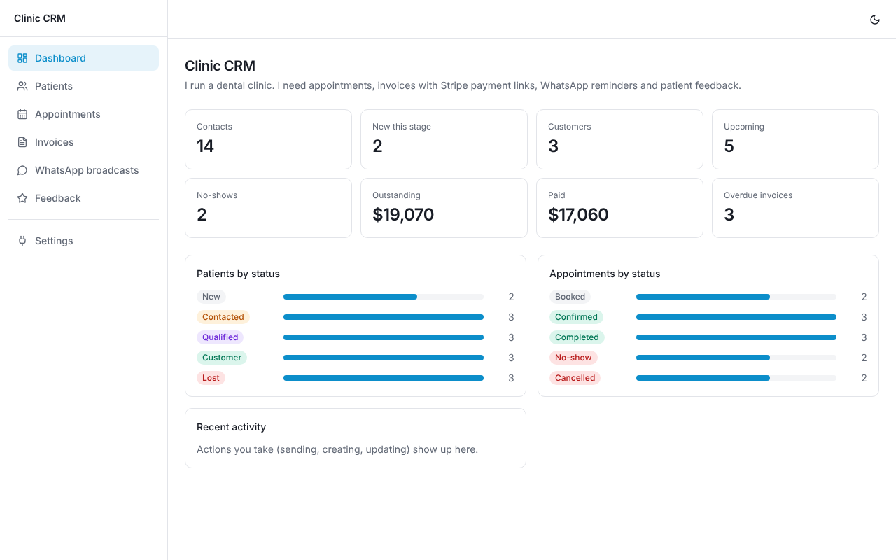

# Reverse Engineer CRM

**Tell it what you do online. Get a CRM or dashboard codebase you own.**

```bash
rcrm generate "I run a dental clinic. Appointments, invoices with Stripe payment links, WhatsApp reminders, patient feedback."
```

A Claude planner turns that sentence (plus, optionally, a CSV export or HAR from your own tools) into a plan, then deterministic code generation assembles a **frontend-only React app** from a fixed theme, a module catalog and a registry of third-party tools. Every integration is a typed stub with `AGENTS.md`, `INTEGRATIONS.md` and an OpenAPI contract, so you add the backend later.

| You say | You get |
| --- | --- |
| "Scraping agents dashboard for competitor prices" | Scraper jobs (URL, schedule, status, Run now) and a results table |
| "WhatsApp bulk messaging to my customers" | Contacts with opt-in, broadcasts (audience, message, send results) |
| "A CRM for emailing my leads" | Contacts, email campaigns by segment, send results |
| "Collect feedback, import Typeform, alert my team on Slack" | Feedback inbox with ratings, sentiment, triage board |
| "Invoicing for my agency clients, Stripe links" | Invoices (status, due dates, payment links), clients, deals, tasks |
| "I run a dental clinic..." | Patients, appointments with reminders and calendar sync, invoices, feedback |

Example blueprints for all of these are in [`examples/`](examples).



*Generated from the clinic sentence above, with no hand edits.*

## How it works

```
 what you do online ──┐
 CSV export (optional) ├─▶ planner ─▶ Brief ─▶ expand ─▶ Blueprint ─▶ generate ─▶ React repo
 HAR of your own       ┘   Claude     (small)   (rules)   (full JSON)   (templates)
                           or offline                                    + AGENTS.md
                                                                         + service stubs
                                                                         + openapi.yaml
```

- **The model plans; code generates.** Claude returns a small structured plan (which catalog modules, labels in your vocabulary, extra fields, tools). It never writes React, so the output builds, looks consistent and is cheap (one call).
- **Catalog.** 10 modules today: contacts, deals, appointments, tasks, invoices, email campaigns, WhatsApp/SMS broadcasts, feedback, scrapers, tickets. Anything else becomes a custom entity inferred from your CSV or the plan.
- **Tool registry.** 25 tools in 10 categories (WhatsApp, SMS, email, payments, scraping, notifications, calendar, forms, CRM sync, sheets/databases). Tools in a category share one method signature, so swapping Twilio for Vonage or SendGrid for Resend never touches the UI.
- **Propose, then adjust.** In a terminal the planner shows its plan and you tweak it with `+id` / `-id`. It asks clarifying questions only when the description is genuinely too vague.

## Install

```bash
git clone https://github.com/shreyvijayvargiya/reverse-engineer-crm
cd reverse-engineer-crm
npm install && npm run build && npm link   # gives you the `rcrm` command
```

Planning with Claude needs credentials (`ANTHROPIC_API_KEY`, or `ant auth login`). Without them use `--offline`.

## Use

```bash
rcrm generate "<what you do>" [--out dir] [--from leads.csv] [--from session.har]
rcrm generate "<what you do>" --offline --yes     # no model call, no prompts
cd <out> && npm install && npm run dev
```

Evolve the result:

```bash
rcrm add scrapers stripe        # modules and tools share one syntax
rcrm remove tickets
rcrm regenerate                 # after editing blueprint.json
```

Other commands: `rcrm modules`, `rcrm tools`, `rcrm analyze <file>`, `rcrm validate <blueprint.json>`, `rcrm from-blueprint <file>`.

### Reverse-engineering your existing tools

`--from` reads **structure only**:

- **CSV** (export from your current tool): column names, inferred types, and category labels for low-cardinality columns (statuses). `--no-values` drops even those. Unmatched data becomes a custom entity.
- **HAR** (captured from your own session in a tool you may inspect): method, path template, status, and JSON key names/types. Headers, cookies, tokens, query values and body values are never read into output (covered by tests).

### In Claude Code (no API key needed)

The repo ships a skill at `.claude/skills/reverse-engineer-crm/`. Claude Code acts as the planner: `rcrm generate --offline`, then `rcrm add` / `rcrm remove` to tune, then builds and verifies.

## What the generated app is

Vite + React + TypeScript + Tailwind + lucide-react. Dashboard stats, tables with search, filters, CSV export and add/edit/delete, drag-and-drop kanban, dark mode, responsive layout, and a Settings page listing integrations.

| Part | State |
| --- | --- |
| UI, tables, kanban, forms | Real |
| Records | Real, in the browser's localStorage |
| Sending, payments, scraping, calendar, sync | **Mocked.** Each tool is `src/services/<tool>.ts`; set `VITE_API_BASE_URL` and it POSTs to `<base>/<tool>/<method>` instead |

Going live means building the backend routes in `openapi.yaml` and swapping `persistence` in `src/lib/store.ts` for your database (`--data-layer supabase` also emits `supabase/schema.sql` with row level security enabled and no policies). Vendor secrets stay on your server.

Files derived from the blueprint carry an `@rcrm-generated` marker and are refreshed by `rcrm regenerate`. Delete the marker to take ownership of a file; static runtime files are written once and never overwritten.

## Status and honest limits

- **Verified:** 33 unit tests; an end-to-end test (`npm run test:e2e`) generates an app with every module and tool, installs it and builds it; the sample clinic CRM was driven in headless Chromium (broadcast send, payment link, create record).
- **Not verified here:** the live Claude call. `src/agent/claude.ts` is one structured-output request validated by schema, and the rest of the planner path is tested with the offline planner and a fake planner, but it has not been run against the real API from CI.
- **One stack today:** Vite + React + Tailwind + lucide. The blueprint is stack-agnostic; Next.js, TanStack Start and other icon sets are new emitters.
- **Mock integrations only.** Vendor endpoints in stubs are scaffolding hints from public docs; verify them before relying on them. 25 tools, not 100+, on purpose: each needs to stay correct.
- **Data layer:** only localStorage runs out of the box. Supabase emits a schema, not an adapter. Firebase/API are documented swap points.
- Changing a blueprint's fields resets the demo data in a browser (the storage key includes a schema signature).
- `rcrm regenerate` does not delete files for removed modules or tools.

## Roadmap

Next.js and TanStack Start emitters, more icon sets and UI-kit theme packs, more tools, SQLite and database-dump analyzers, an MCP server so any agent can call the planner, in-browser live preview, backend scaffold emitters (Hono/Express routes from `openapi.yaml`).

## Responsible use

Rebuild **your own** workflow. Do not use this to copy someone else's product, and only analyze files you own or may inspect. Generated messaging features are opt-in gated but you are responsible for consent and provider rules; scraping must respect site terms. See [DISCLAIMER.md](DISCLAIMER.md).

## Contributing

See [AGENTS.md](AGENTS.md) for architecture, invariants and how to add modules, tools and stacks.

MIT licensed.
